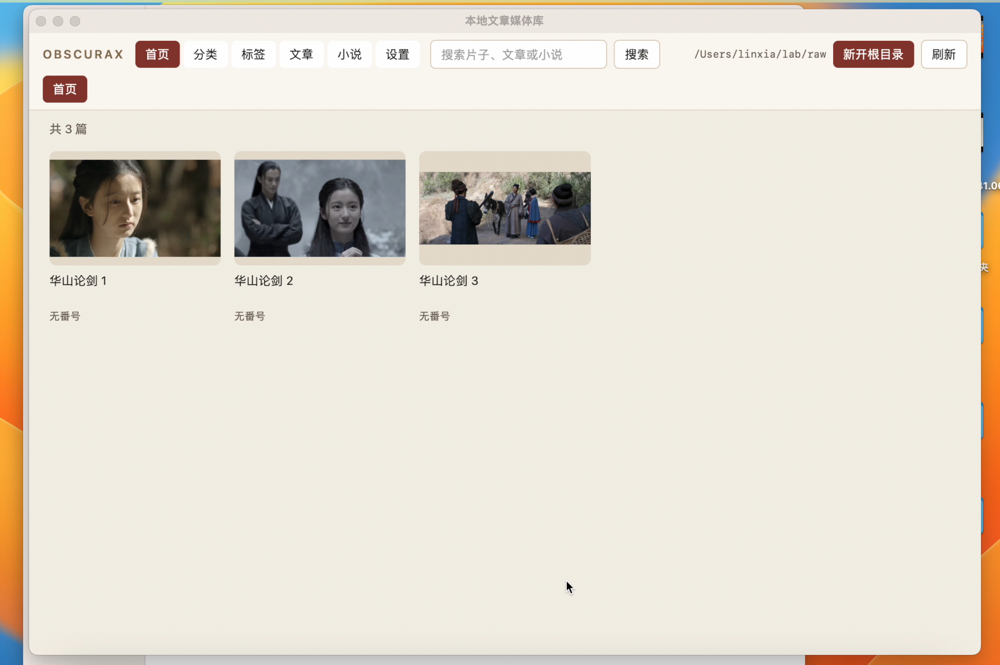
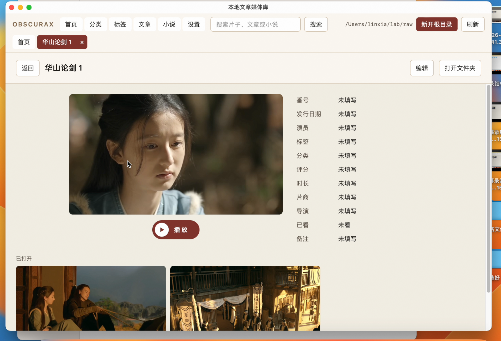
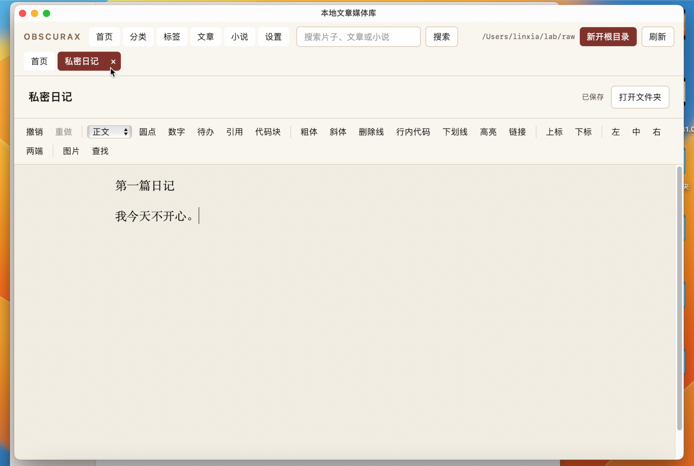
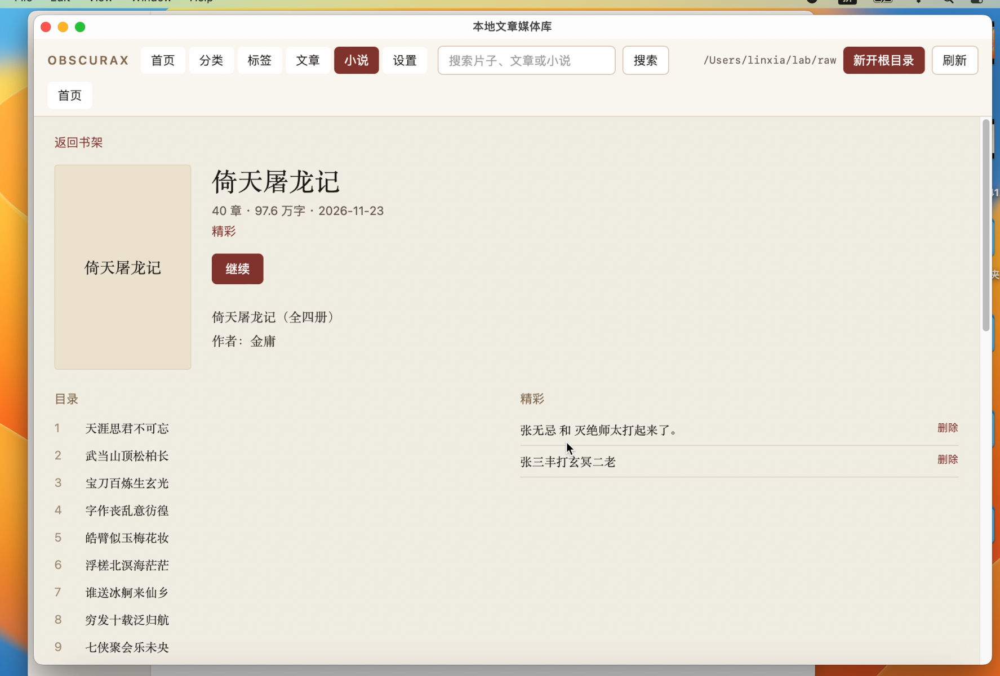

# fanMediaLib

**ObscuraX — Your Local Personal Content Library**

> About the name: fanMediaLib is the GitHub repository and project name. ObscuraX is the name of the desktop application.

A desktop application for organizing, browsing, reading, and managing your personal content.

ObscuraX turns ordinary folders on your computer into a personal content library. Manage images, videos, personal articles, and TXT novels in one place, while keeping your original files on your own disk.

No cloud upload. No forced import into a database. Your files remain yours.

## What Can You Do with ObscuraX?

ObscuraX brings three types of personal content together.

### 1. Images & Videos

Turn ordinary folders into browsable media collections.

- Browse your collections in a cover-based gallery.
- View images and read accompanying text.
- Browse image galleries in sequence.
- Edit titles, descriptions, codes, actors, tags, and other information.
- Filter collections by actors, tags, categories, and viewing status.
- Automatically organize images into readable content.
- Open videos with your preferred external video player.

Each collection is stored in its own folder, making it easy to manage files outside the application.

### 2. Personal Articles

A place for your own articles, notes, and written content.

- Create and organize articles in folders.
- Write and edit articles directly in ObscuraX.
- Format text with headings, lists, quotes, links, images, and more.
- Keep article files and images together.
- Browse and edit your articles in one place.

Your articles are stored as ordinary HTML files.

### 3. TXT Novels

A personal bookshelf for your TXT novels.

- Browse your novels in a bookshelf.
- Automatically recognize common chapter formats.
- Read novels chapter by chapter.
- Save your reading progress.
- Add bookmarks and annotations.
- See annotation markers and reading progress.
- Customize reading fonts and font sizes.

Your original TXT files remain intact. Reading progress and annotations are saved separately.

## Screenshots

  

### Media Library



Browse your personal collections in a cover-based gallery.

### Reading Experience


Read text and browse images together in a clean reading layout.

### Article Editor

 

Write and organize your personal articles.

### Novel Reader



Read novels chapter by chapter and keep your annotations.

## Supported Platforms

| Platform | Availability |
| --- | --- |
| Windows 11 | Primary platform. Installation packages are available. |
| macOS | Successfully built and packaged on Apple Silicon (Mac M2, macOS 13.7.8). Intel Mac compatibility has not been separately verified. |
| Linux | Not currently available. |

ObscuraX is a desktop application, not a web application or mobile app.

## Installation

### Windows

Download the Windows installer from the project's GitHub Releases page.

Run the installer and launch ObscuraX.

### macOS

Download the macOS application package from GitHub Releases.

The application is currently unsigned. On first launch, you may need to right-click the application in Finder and select **Open**.

## Getting Started

### Step 1: Choose Your Library Folder

On first launch, select a folder on your computer as your library root.

For example:

```text
MyLibrary/
```

ObscuraX remembers your selected library folders, so you do not need to select them every time.

You can also open another library in a separate application window.

### Step 2: Add Your Content

You do not need to import files into ObscuraX.

Simply organize your existing files into the corresponding folders.

A typical library looks like this:

```text
MyLibrary/
│
├── Collection A/
│   ├── cover.jpg
│   ├── content.md
│   ├── meta.json
│   ├── image001.jpg
│   └── video.mp4
│
├── Collection B/
│   ├── cover.png
│   └── image001.png
│
├── 文章/
│   ├── Programming/
│   │   ├── article.html
│   │   └── meta.json
│   │
│   └── Reading Notes/
│       ├── article.html
│       └── meta.json
│
└── book/
    ├── Novel A.txt
    ├── Novel A.json
    └── Novel A.jpg
```

### Step 3: Browse and Read

Open ObscuraX to browse your collections, articles, and novels.

You can edit content, add annotations, manage metadata, and search across different content types.

When you add, modify, or delete files outside the application, refresh the current page to update the displayed content.

## How Your Files Are Stored

**Your library is an ordinary folder on your computer.**

ObscuraX does not require you to move your files into a proprietary database.

Your content stays in its original folder structure and can be accessed using File Explorer or Finder.

### Images & Videos

Each collection uses one folder.

| File | Purpose |
| --- | --- |
| `cover.jpg` | Collection cover |
| `content.md` | Text and image content |
| `meta.json` | Meta information |
| Other image files | Collection images |
| Video files | Videos associated with the collection |

Supported image formats: JPG, JPEG, PNG, WEBP.

Supported video formats: MP4, MKV, AVI, WMV, MOV, WEBM, M4V, FLV, TS, M2TS, MTS, MPEG, MPG, VOB.

Images and videos should be placed directly inside the collection folder.

### Personal Articles

Articles are stored in the `文章/` folder.

Each article has its own folder containing:

- `article.html` — Article content.
- `meta.json` — Article information.
- Image files — Images used in the article.

### TXT Novels

Novels are stored in the `book/` or `小说/` folder.

Each novel consists of:

- `.txt` — Original novel text.
- `.json` — Reading progress, annotations, and other information.
- Optional image — Book cover, using the same filename as the TXT file.

TXT files must use UTF-8 encoding without BOM.

## Where Is My Data Stored?

ObscuraX keeps library content separate from application settings and temporary files.

| Data | Storage location |
| --- | --- |
| Images, videos, and collection content | Your selected library folder |
| Personal articles | `文章/` inside your library |
| Novels and reading annotations | `book/` or `小说/` inside your library |
| Application settings | System application configuration directory |
| Image thumbnails | System application cache directory |

Thumbnails and application settings are not stored inside your library folders.

This means you can back up your actual content by copying your library folder.

**Important:** Application settings and cached thumbnails are stored separately. Copying your library folder does not automatically transfer those settings.

### Your Files, Your Control

- Files remain accessible outside ObscuraX.
- You can organize folders using your operating system's file manager.
- You can back up your library by copying its folder.
- Removing a library from ObscuraX does not delete its files.
- Deleting content means deleting the corresponding files or folders yourself.

## Search

Search across your library using one search box.

Current search coverage:

- Media collections: titles, codes, and Markdown content.
- Articles: folder names, paths, and HTML text.
- Novels: TXT filenames.

Search currently uses case-insensitive substring matching.

Searching inside novel content and chapters is planned for a future version.

## Frequently Asked Questions

**Do I need to import my existing files?**

No. Select a library folder and organize your files using your normal file manager. ObscuraX reads supported folders directly.

**Are my files uploaded to the cloud?**

ObscuraX is designed as a local desktop application. Your library content is stored on your computer rather than in a cloud-hosted library.

**Can I use my own video player?**

Yes. You can configure an external video player in Settings. ObscuraX opens the selected video using that player.

**Can I move my library to another drive?**

Yes. Your content is stored in ordinary folders, so you can copy the library to another drive. You may need to select the new folder location in ObscuraX.

**Does ObscuraX modify my original files?**

ObscuraX reads your files directly. Some operations, such as editing article content, saving annotations, updating metadata, or organizing images, write changes to the corresponding files. Your original TXT novel text is not rewritten by the annotation system.

**Can I request additional features or a customized interface?**

Yes. If you need a different interface, additional functionality, or a version tailored to your workflow, feel free to contact me.

I welcome feedback, feature requests, and customization discussions.

## Customization & Contact

ObscuraX is developed around a flexible local content management workflow.

If you are interested in:

- Custom interface layouts.
- Additional content types.
- New reading or browsing features.
- Workflow-specific functionality.
- Custom versions for personal or business use.

You can contact me through GitHub to discuss your requirements.

I'm open to exploring practical customizations based on your needs.

---

**fanMediaLib — ObscuraX**

Your personal content, organized your way.
